# Product API on ECS

My Product API for the online store homework. It implements the two Product endpoints from `api.yaml` in Go with Gin, keeps products in memory, runs in Docker, and deploys to AWS ECS (Fargate) with Terraform.

Only the Product part of `api.yaml` is implemented. Shopping carts, the warehouse and payments are not part of this assignment.

This repo is a fork of the starter repo `RuidiH/CS6650_2b_demo`. I replaced its albums server with my Product API.

## Where things are

```text
.
├── src/                      server code and Dockerfile
│   ├── product-service.go    the server
│   ├── go.mod / go.sum       Go module files
│   └── Dockerfile            builds the server image
├── terraform/                infrastructure
│   ├── provider.tf           AWS and Docker providers
│   ├── variables.tf          region, names, port, task count
│   ├── main.tf               connects the modules, builds and pushes the image
│   ├── outputs.tf            cluster and service names
│   └── modules/              network, ecr, logging, ecs
├── locust/                   load tests
│   ├── locustfile.py         request mix, HttpUser and FastHttpUser classes
│   └── stressfile.py         step-load stress test
├── requests/                 JSON bodies used with curl
├── postman/                  exported Postman collection
└── docs/screenshots/         screenshots for every part
```

## Deploying to AWS

These steps set everything up from scratch on a new machine. Commands are for Windows PowerShell unless marked otherwise.

### What you need

- **Docker Desktop**, running. Terraform builds the image locally before pushing it.
- **Terraform** 1.x
- **AWS CLI** v2
- **Git**
- An **AWS Academy Learner Lab** session. The Terraform code uses the lab's existing `LabRole`, so it expects a Learner Lab account.

Go itself is only needed to run the server locally. The Docker build compiles the code inside the container.

### 1. Clone the repo

```powershell
git clone https://github.com/ctrlShree/CS6650_HW05.git
cd CS6650_HW05
```

### 2. Add your AWS credentials

1. In Learner Lab, click **Start Lab** and wait for the green dot.
2. Click **AWS Details**, then **AWS CLI: Show**, and copy the whole `[default]` block.
3. Paste it into your credentials file, replacing anything already there:

   ```powershell
   notepad $HOME\.aws\credentials
   ```

   On macOS or Linux the file is `~/.aws/credentials`.

   Or, the way the starter repo does it, enter the key ID and secret when `aws configure` prompts (use `us-west-2` for the region), then add the session token separately:

   ```powershell
   aws configure
   aws configure set aws_session_token <YOUR-TEMP-SESSION-TOKEN>
   ```

4. Check it works:

   ```powershell
   aws sts get-caller-identity
   ```

Learner Lab credentials expire when the session ends. If Terraform starts failing with `ExpiredToken` or "security token included in the request is invalid", paste a fresh block.

### 3. Deploy

```powershell
cd terraform
terraform init
terraform plan
terraform apply
```

Type `yes` when `apply` asks, or use `terraform apply -auto-approve` to skip the prompt. It builds the image from `src/`, pushes it to ECR, and creates the rest. The first run takes about two minutes and ends with:

```text
Apply complete! Resources: 8 added, 0 changed, 0 destroyed.

Outputs:

ecs_cluster_name = "product-api-cluster"
ecs_service_name = "product-api"
```

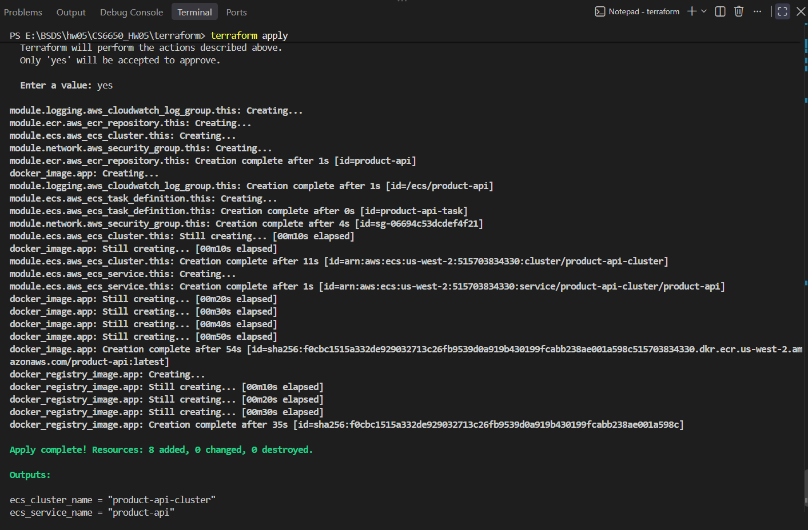

Everything is created in **us-west-2 (Oregon)**. Look there in the AWS console.

### 4. Find the public IP

The task can take a minute or two to start after `apply` finishes. Then, from the `terraform` folder:

**PowerShell**

```powershell
$env:AWS_DEFAULT_REGION = "us-west-2"
$cluster = terraform output -raw ecs_cluster_name
$service = terraform output -raw ecs_service_name
$task = aws ecs list-tasks --cluster $cluster --service-name $service --query "taskArns[0]" --output text
$eni = aws ecs describe-tasks --cluster $cluster --tasks $task --query "tasks[0].attachments[0].details[?name=='networkInterfaceId'].value" --output text
aws ec2 describe-network-interfaces --network-interface-ids $eni --query "NetworkInterfaces[0].Association.PublicIp" --output text
```

**macOS or Linux (bash)**

```bash
export AWS_DEFAULT_REGION=us-west-2
CLUSTER=$(terraform output -raw ecs_cluster_name)
SERVICE=$(terraform output -raw ecs_service_name)
TASK=$(aws ecs list-tasks --cluster "$CLUSTER" --service-name "$SERVICE" --query 'taskArns[0]' --output text)
ENI=$(aws ecs describe-tasks --cluster "$CLUSTER" --tasks "$TASK" --query "tasks[0].attachments[0].details[?name=='networkInterfaceId'].value" --output text)
aws ec2 describe-network-interfaces --network-interface-ids "$ENI" --query 'NetworkInterfaces[0].Association.PublicIp' --output text
```

If the task ARN comes back as `None`, the task hasn't started yet. Wait a minute and run it again. The IP changes whenever the task restarts, so look it up again rather than reusing an old one.

The task shows as **Running** in the ECS console under **Clusters**, **product-api-cluster**, **Tasks**:

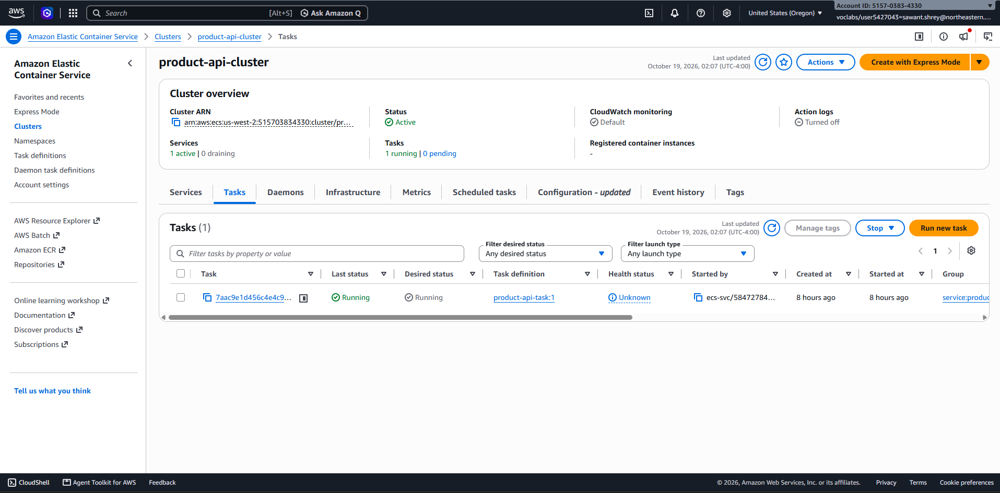

### 5. Send requests

```powershell
curl.exe -i http://<PUBLIC-IP>:8080/products/1
```

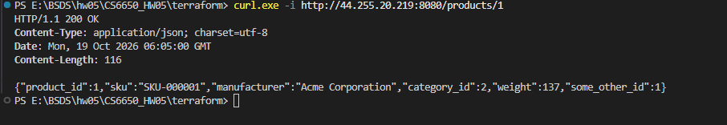

Every request in the [examples section](#example-calls-for-every-response-code) works against AWS too. Swap `localhost:8080` for `<PUBLIC-IP>:8080`.

**With Postman:** import `postman/product-api.postman_collection.json`, create an environment with `baseUrl` set to `http://<PUBLIC-IP>:8080`, select it, and run the collection. Against AWS, **8 of 10 tests pass**. The two 500 tests fail by design: fault injection isn't turned on in the ECS task, so the `X-Simulate-Error` header is ignored and those requests return 200 and 204. Nobody can force a 500 on the deployed server.

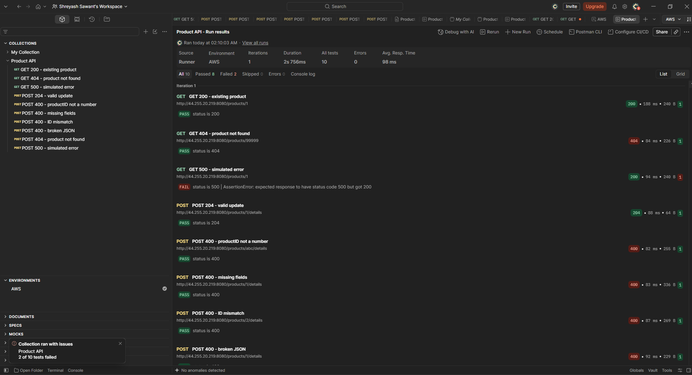
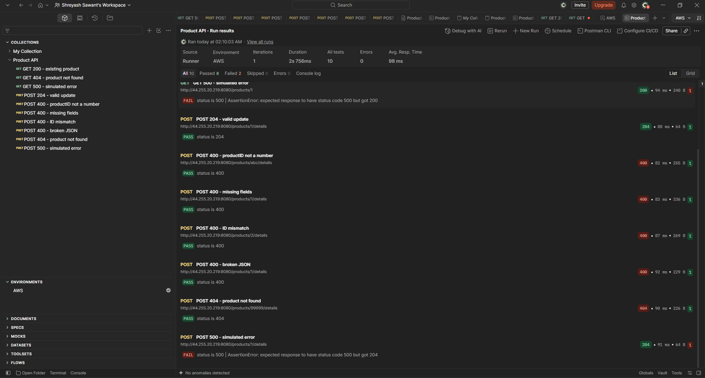

The average response time against AWS was about 98 ms, against 7 ms locally. Nearly all of that difference is the network round trip to Oregon.

### Updating after a code change

The image is always tagged `latest`, so Terraform doesn't notice when the Go code changes. To rebuild, push and restart:

```powershell
cd terraform
terraform apply -replace="docker_image.app" -replace="docker_registry_image.app"
aws ecs update-service --cluster product-api-cluster --service product-api --force-new-deployment --region us-west-2
```

The first command rebuilds and pushes the image. The second tells ECS to start a new task, which pulls the new image. The public IP changes afterwards.

### Tearing it down

```powershell
cd terraform
terraform destroy
```

Type `yes`, or use `terraform destroy -auto-approve`. Ending the Learner Lab session does **not** stop the Fargate task, so destroy when you're finished to save lab credit.

If `destroy` fails with `RepositoryNotEmptyException`, ECR is refusing to delete a repository that still holds images. Add `force_delete = true` to the `aws_ecr_repository` resource in `terraform/modules/ecr/main.tf` and run `terraform destroy` again.

### Troubleshooting

| Problem | Fix |
|---|---|
| `Cannot connect to the Docker daemon at unix:///var/run/docker.sock` (Windows) | Start Docker Desktop. If it still fails, add `host = "npipe:////./pipe/docker_engine"` inside the `provider "docker"` block in `terraform/provider.tf`. |
| `ExpiredToken` or invalid security token | The Learner Lab session ended. Paste fresh credentials. |
| `curl` times out | The task is still starting, or it restarted with a new IP. Wait, then look the IP up again. |
| Task stops with `exec format error` | The image was built for ARM (Apple Silicon). Add `platform = "linux/amd64"` to the `build` block of `docker_image.app` in `terraform/main.tf`. |

### What I changed from the starter repo

| File | Change |
|---|---|
| `src/main.go` | Deleted (the albums server) |
| `src/product-service.go`, `src/go.mod`, `src/go.sum` | Added my Product API |
| `src/Dockerfile` | Replaced with my two-stage Dockerfile from Part II |
| `terraform/variables.tf` | `service_name` and `ecr_repository_name` changed from the HW2 names to `product-api` |
| `.gitignore` | Kept the starter's Terraform rules and added Go binaries, secrets and editor files |

The port didn't need changing. My server listens on 8080, which is already the default `container_port`.

### How the Terraform files connect

`main.tf` calls four modules and passes outputs from one into another:

| Module | Creates | Passes on |
|---|---|---|
| `network` | finds the default VPC and subnets, creates a security group open on 8080 | `subnet_ids`, `security_group_id` |
| `ecr` | an ECR repository | `repository_url` |
| `logging` | a CloudWatch log group, `/ecs/product-api` | `log_group_name` |
| `ecs` | a cluster, a Fargate task definition (256 CPU units, 512 MB) and a service with a public IP | `cluster_name`, `service_name` |

`main.tf` also builds the image from `../src` and pushes it to the ECR URL. `provider.tf` gets an ECR login token from AWS, so the Docker provider can push without a manual `docker login`. `outputs.tf` prints the names the IP lookup uses. Because `ecs` refers to `module.ecr.repository_url`, Terraform knows to create the repository before anything that needs it.

## Running the server locally

You need Go 1.27 or newer, and Docker if you want the container.

**With Go**, from the repo root:

```powershell
cd src
go run .
```

**With Docker**, from the repo root:

```powershell
docker build -t product-service ./src
docker run --rm -p 8080:8080 product-service
```

Either way the server listens on port 8080 and starts with products 1 to 100 already loaded.

To be able to trigger the 500 responses (see below), start it with fault injection turned on:

```powershell
# go run, in PowerShell
$env:ENABLE_FAULT_INJECTION="true"; go run .

# Docker
docker run --rm -p 8080:8080 -e ENABLE_FAULT_INJECTION=true product-service
```

## Endpoints

| Endpoint | Code | When |
|---|---|---|
| `GET /products/{productId}` | 200 | The product exists. Body is the Product JSON. |
| | 404 | No product has that ID, including IDs that can't be valid like `abc` or `0`. |
| | 500 | Server error. |
| `POST /products/{productId}/details` | 204 | Details saved. No body. |
| | 400 | Bad path ID, broken JSON, a missing or out-of-range field, or a body `product_id` that doesn't match the path. |
| | 404 | No product has that ID. |
| | 500 | Server error. |

Every 400, 404 and 500 comes back in the `Error` format from `api.yaml`: `error`, `message`, and a `details` string saying what went wrong.

POST checks these rules from the `Product` schema. All six fields are required.

| Field | Rule |
|---|---|
| `product_id` | integer, 1 to 2147483647, and must match the ID in the URL |
| `sku` | string, 1 to 100 characters |
| `manufacturer` | string, 1 to 200 characters |
| `category_id` | integer, 1 to 2147483647 |
| `weight` | integer, 0 to 2147483647 (grams, so 0 is allowed) |
| `some_other_id` | integer, 1 to 2147483647 |

### Decisions I made where `api.yaml` leaves a gap

**Products are pre-loaded.** `api.yaml` has no endpoint that creates a product, and the POST endpoint lists a 404 for a product that doesn't exist. So the server starts with products 1 to 100, POST updates one of them, and any other ID gets a 404. That way every listed code can actually happen.

**A bad ID on GET returns 404.** GET only lists 200, 404 and 500. There's no 400, so `/products/abc` gets a 404 with the reason in `details`. Nothing can exist at that ID, so "not found" is accurate. POST does list 400, so a bad ID there is a 400.

**How the 500 is triggered.** A working server shouldn't return 500 by itself, but the assignment asks to show every code. When the server is started with `ENABLE_FAULT_INJECTION=true`, a request with the header `X-Simulate-Error: 500` makes the handler panic. Gin's recovery middleware catches the panic and my recovery function returns a 500 in the `Error` format. Without the environment variable the header is ignored.

**Auth isn't checked.** `api.yaml` declares API key and bearer token security, but the Product endpoints list no 401 or 403, so the server doesn't check them.

## Example calls for every response code

The commands are for Windows PowerShell, run from the repo root. On macOS or Linux, use `curl` instead of `curl.exe` and forward slashes in the file paths (`@requests/valid.json`).

The POST bodies are in `requests/`. Sending them from files avoids PowerShell's problems with quotes inside JSON.

### GET /products/{productId}

**200, product found**

```powershell
curl.exe -i http://localhost:8080/products/1
```

```json
{"product_id":1,"sku":"SKU-000001","manufacturer":"Acme Corporation","category_id":2,"weight":137,"some_other_id":1}
```

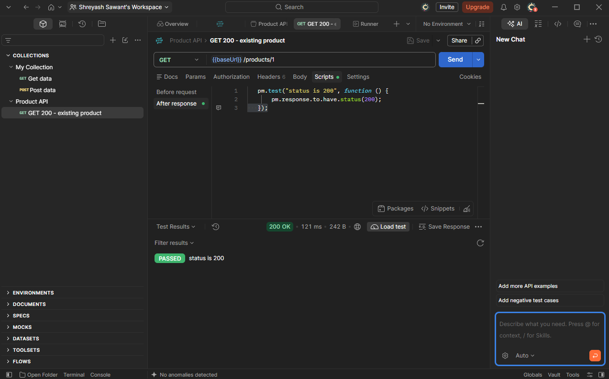

**404, product not found**

```powershell
curl.exe -i http://localhost:8080/products/99999
```

```json
{"error":"PRODUCT_NOT_FOUND","message":"Product not found","details":"no product with ID 99999"}
```

`/products/abc` and `/products/0` also return 404, with `"details":"productId must be an integer between 1 and 2147483647"`.

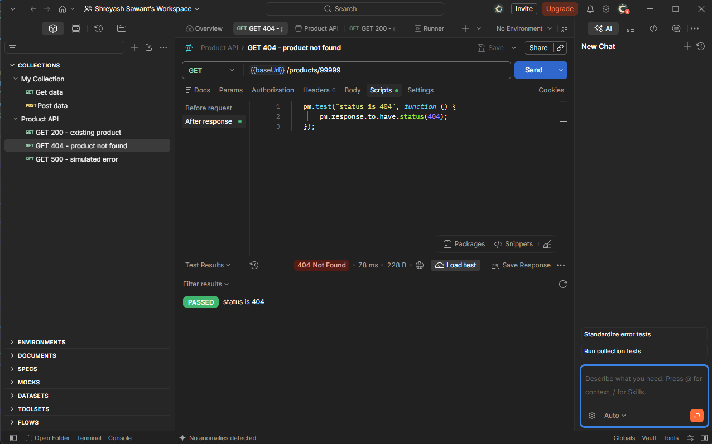

**500, server error** (fault injection on)

```powershell
curl.exe -i http://localhost:8080/products/1 -H "X-Simulate-Error: 500"
```

```json
{"error":"INTERNAL_ERROR","message":"Internal server error","details":"unexpected server error"}
```

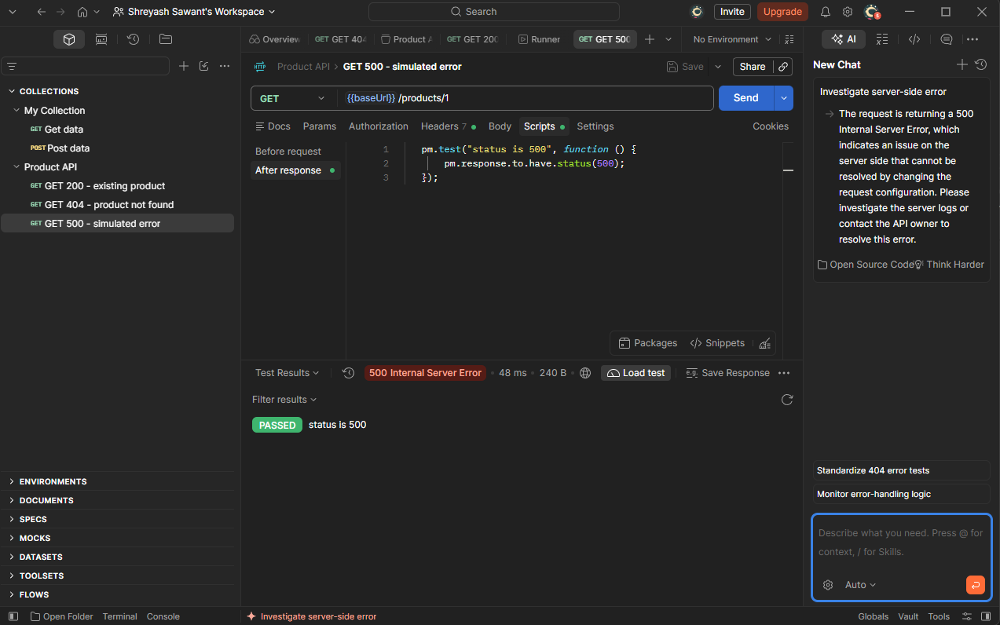

### POST /products/{productId}/details

**204, details saved**

```powershell
curl.exe -i -X POST http://localhost:8080/products/1/details -H "Content-Type: application/json" --data-binary "@requests\valid.json"
```

No body comes back. Running the GET for product 1 afterwards shows the new values.

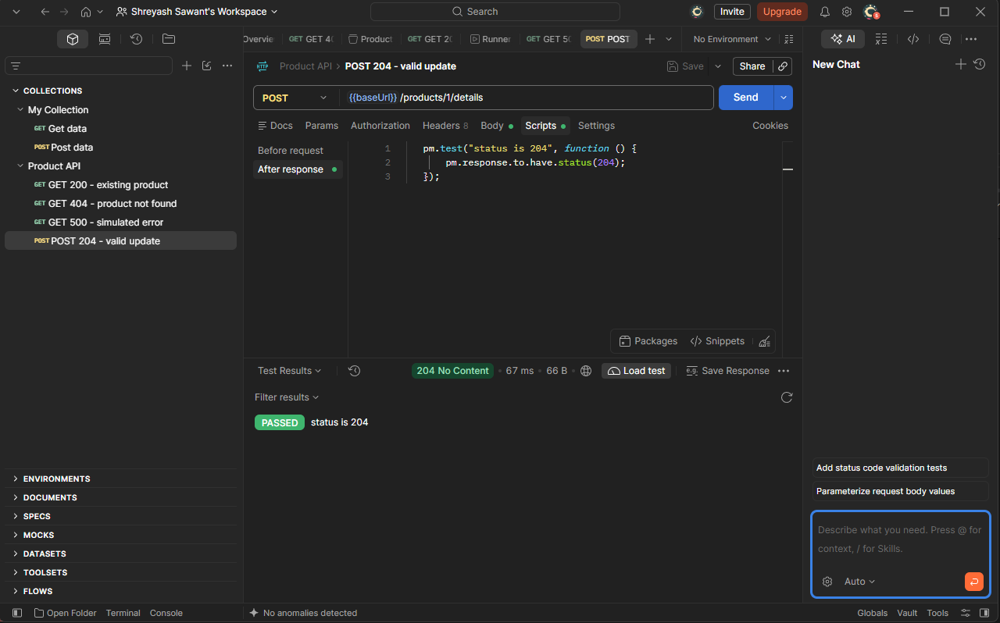

**400, invalid input.** There are four ways to get one:

```powershell
# path ID isn't a number
curl.exe -i -X POST http://localhost:8080/products/abc/details -H "Content-Type: application/json" --data-binary "@requests\valid.json"

# missing and invalid fields
curl.exe -i -X POST http://localhost:8080/products/1/details -H "Content-Type: application/json" --data-binary "@requests\missing-fields.json"

# body product_id (1) doesn't match the path (2)
curl.exe -i -X POST http://localhost:8080/products/2/details -H "Content-Type: application/json" --data-binary "@requests\valid.json"

# broken JSON
curl.exe -i -X POST http://localhost:8080/products/1/details -H "Content-Type: application/json" --data-binary "@requests\broken.json"
```

They all return `"error":"INVALID_INPUT","message":"Invalid input data"` with a different `details`:

| Case | `details` |
|---|---|
| path ID isn't a number | `productId must be an integer between 1 and 2147483647` |
| missing fields | `sku must be 1 to 100 characters long; manufacturer is required; category_id is required; weight is required; some_other_id is required` |
| ID mismatch | `product_id in the body (1) does not match productId in the path (2)` |
| broken JSON | `invalid JSON: unexpected EOF` |

ID mismatch:

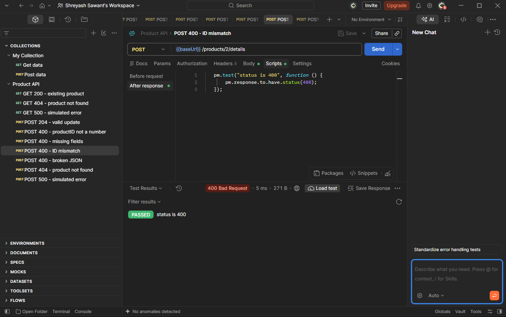

Broken JSON:

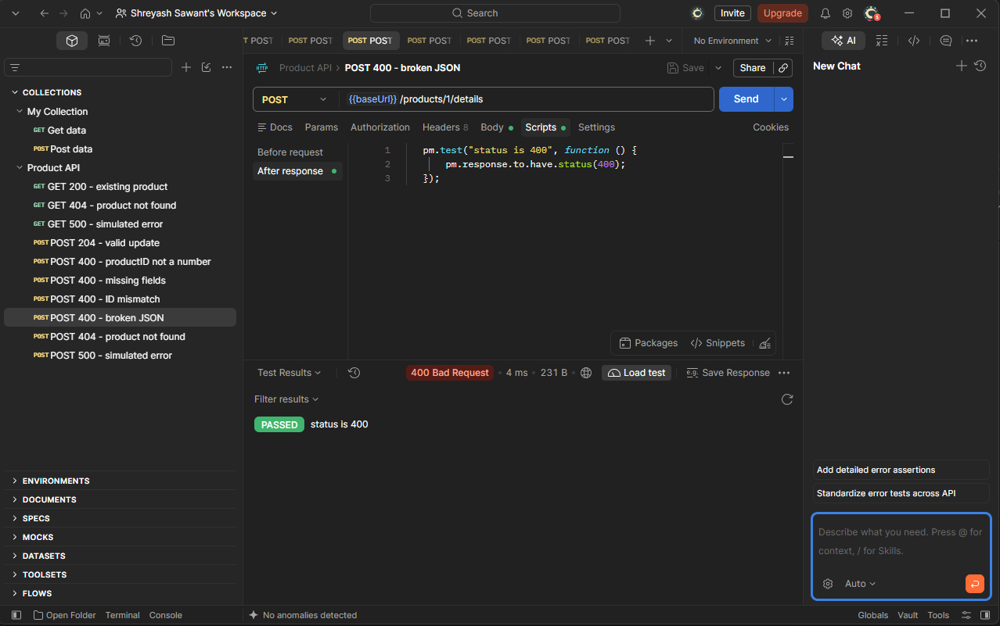

**404, product not found**

```powershell
curl.exe -i -X POST http://localhost:8080/products/99999/details -H "Content-Type: application/json" --data-binary "@requests\missing-product.json"
```

```json
{"error":"PRODUCT_NOT_FOUND","message":"Product not found","details":"no product with ID 99999"}
```

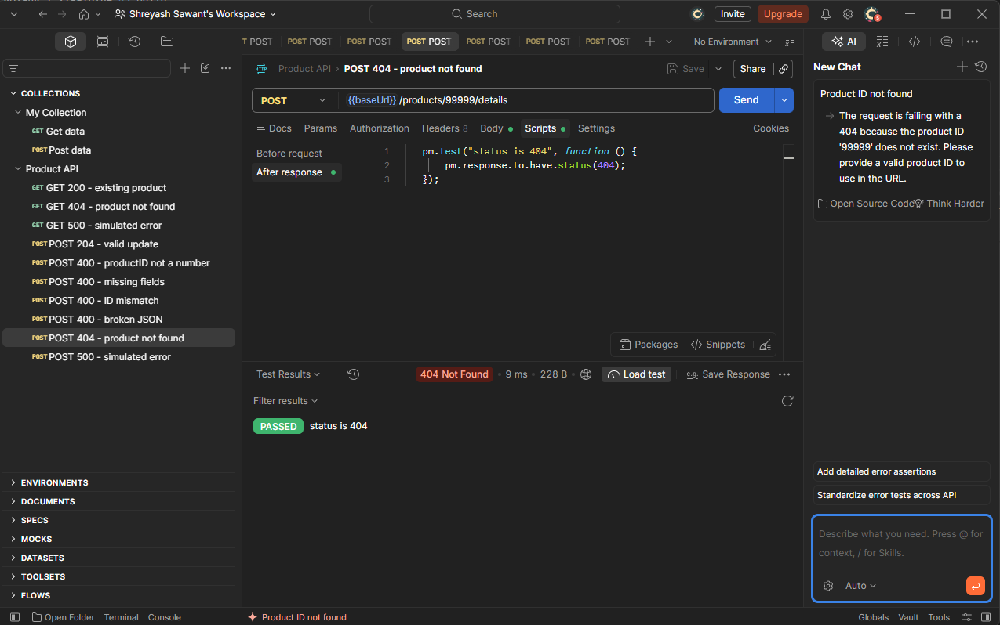

**500, server error** (fault injection on)

```powershell
curl.exe -i -X POST http://localhost:8080/products/1/details -H "Content-Type: application/json" -H "X-Simulate-Error: 500" --data-binary "@requests\valid.json"
```

```json
{"error":"INTERNAL_ERROR","message":"Internal server error","details":"unexpected server error"}
```

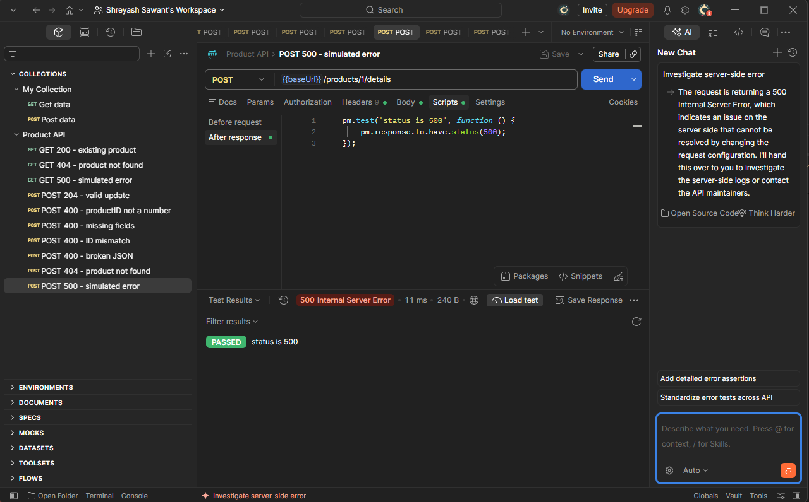

## Postman collection

`postman/product-api.postman_collection.json` holds all 10 requests above, each with a test that checks the status code. To use it:

1. In Postman, click **Import** and choose the file.
2. Start the server with fault injection on.
3. Right-click the **Product API** collection and choose **Run collection**.

`baseUrl` is set to `http://localhost:8080`. Change it in the collection's **Variables** tab to test a different server.

## Testing with `go run` and Docker

I ran the whole collection against both local setups. All 10 tests passed each time.

**Against the Docker container:**

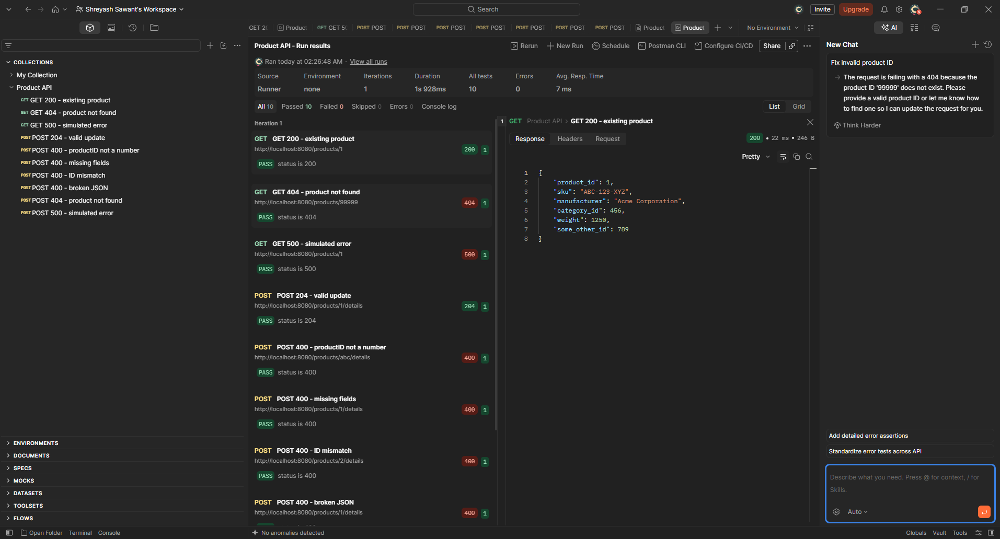
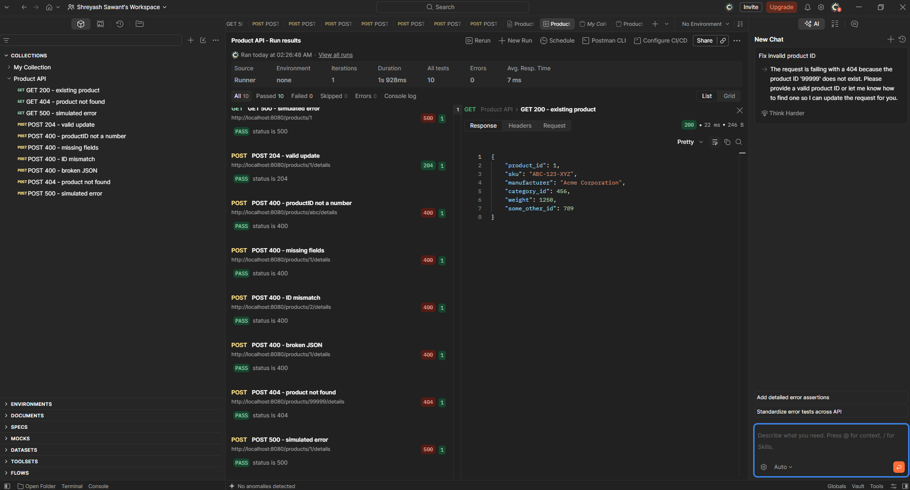

The container's own logs show every status code arriving:

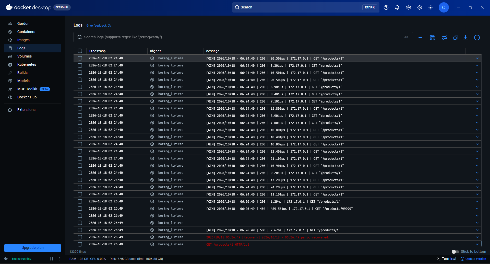
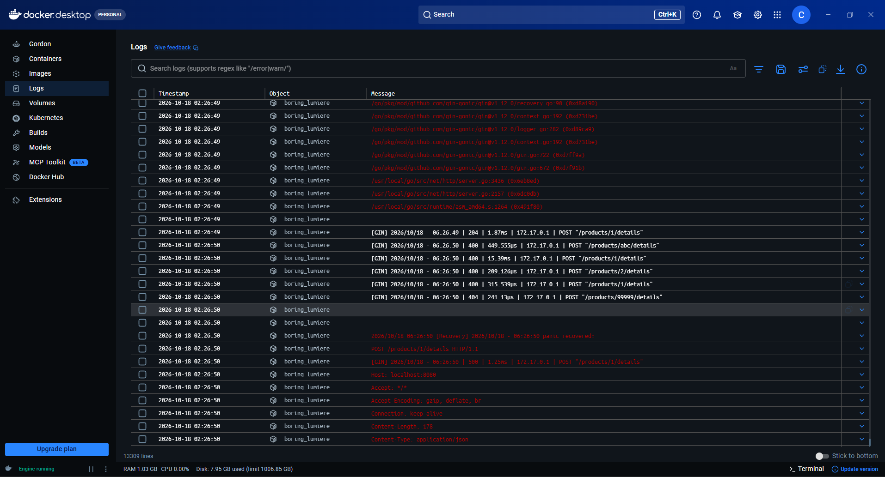

**Against `go run`:**

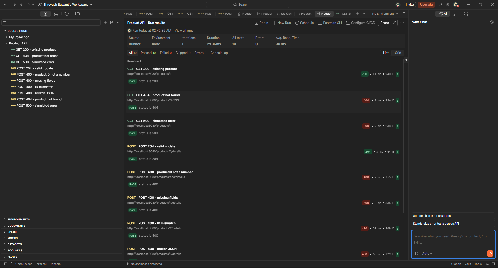
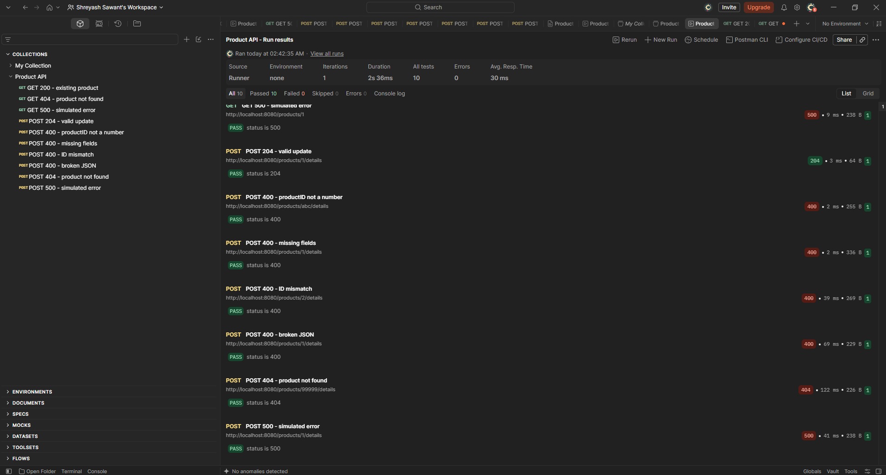

In the `go run` run, `GET 200` returns the original `SKU-000001`, while the Docker run returned the updated `ABC-123-XYZ`. The data only lives in memory, so a freshly started server begins again with the seeded products.

## Load testing with Locust

All tests ran from my laptop (Intel i5-10300H, 4 cores, 8 logical processors) against the ECS task in us-west-2. The task has 256 CPU units, a quarter of one vCPU.

### Running the tests

Install Locust with `pip install locust`. From the `locust` folder:

```powershell
# web UI on http://localhost:8089; pick the user class at the end
locust -f locustfile.py --host http://<PUBLIC-IP>:8080 ProductHttpUser
locust -f locustfile.py --host http://<PUBLIC-IP>:8080 ProductFastHttpUser
```

The stress test needs more than one Locust process so the laptop doesn't become the limit. On Windows Locust can't start workers itself, so open one terminal for the master and one per worker:

```powershell
# terminal 1
locust -f stressfile.py --master --host http://<PUBLIC-IP>:8080 ProductFastHttpUser

# terminals 2 to 5, one worker each
locust -f stressfile.py --worker ProductFastHttpUser
```

Open http://localhost:8089, check it shows 4 workers, and click Start. The step shape in `stressfile.py` controls the user count, so the numbers typed into the UI are ignored.

### Test design

| Setting | Value | Why |
|---|---|---|
| Request mix | 80% GET an existing product, 15% POST new details, 5% GET a product that doesn't exist | A store is read far more than it's edited. The 404s are expected and marked as successes, so the failure column only shows real problems. |
| Product IDs | random, 1 to 100 | The server seeds products 1 to 100, and POST returns 404 for anything else |
| Wait time | none | Each user sends its next request as soon as the last one returns, which puts the most pressure on the server |
| Comparison runs | 100 users, spawn rate 10/s, about 2 minutes each | Enough load to see a difference between the clients, same settings for both |
| Stress run | start at 200 users, add 200 every 45 s, stop at 2,000 (`stressfile.py`) | Small enough steps to see where throughput stops rising |
| Stress client | FastHttpUser, 1 master and 4 workers | Keeps my laptop out of the way so the server is what gets tested |

With no wait time, throughput is about users ÷ response time. That gives a quick check on every run: if the measured req/s falls well below that number, something is queuing.

### HttpUser vs FastHttpUser

| | HttpUser | FastHttpUser |
|---|---|---|
| Requests | 116,059 | 126,629 |
| Throughput | 1,025 req/s | 1,094 req/s |
| Median | 94 ms | 90 ms |
| p95 | 110 ms | 98 ms |
| p99 | 150 ms | 110 ms |
| Failures | 0 | 0 |
| Locust CPU in Task Manager | 9 to 12% of the machine, about 72 to 96% of one core | 4.6 to 7%, about 37 to 56% of one core |
| Server CPU (ECS) | ~55% | ~57% |

**HttpUser**

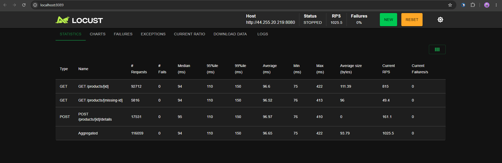
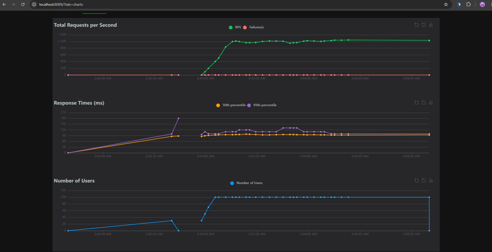

**FastHttpUser**

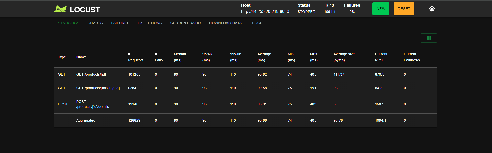
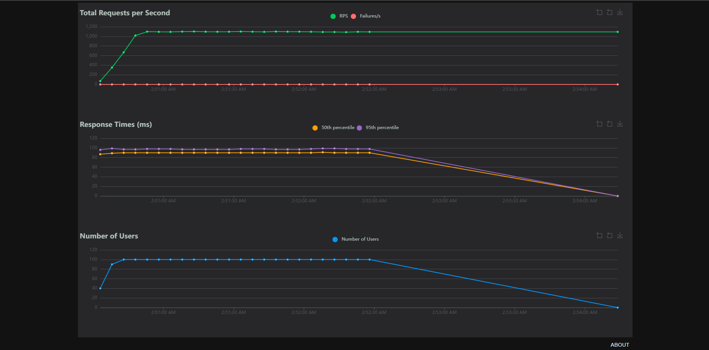

There was a difference. FastHttpUser got 7% more throughput, cut p99 latency by 40 ms, and used about half as much CPU on my laptop. The server and network were the same both times, so the difference comes from Locust.

HttpUser is built on python-requests, which does a lot of work in plain Python for every request: building a request object, merging headers and cookies, running hooks, going through urllib3's connection pool. FastHttpUser uses geventhttpclient, which is written for gevent (the library Locust uses to run many users in one process) and does its HTTP parsing in C. Same requests, less work per request.

That matters because all 100 users share one Python process, which mostly runs on one core. With HttpUser that core was close to full, so users waited their turn to send a request and to read the reply. Locust's timer is running during that wait, so the delay shows up as response time, mostly in the slowest requests. That's why p99 moved much more than the median.

The throughput gap was small because both runs were close to the limit set by the network. The round trip to Oregon is about 85 ms, and 100 users ÷ 0.09 s ≈ 1,100 req/s, which is about what both clients reached. At higher load HttpUser would hit its CPU limit first, and Locust would report a slower server even if the server were fine. Checking the load generator's CPU is the only way to tell the two apart.

### Stress test

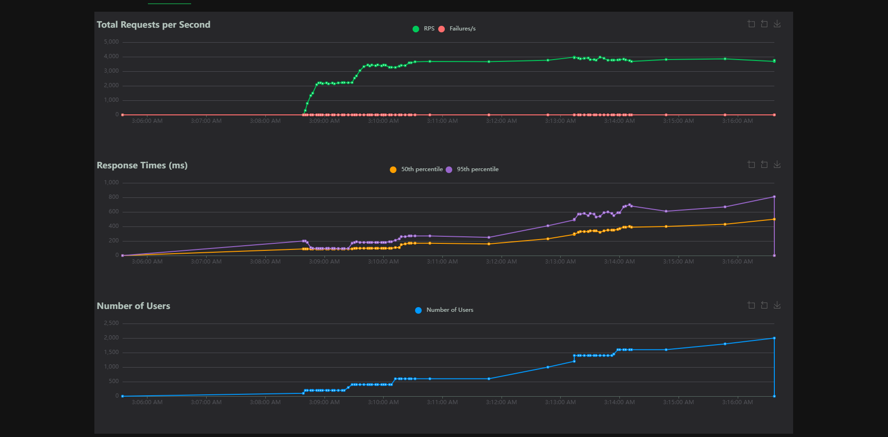


1,600,763 requests, 0 failures:

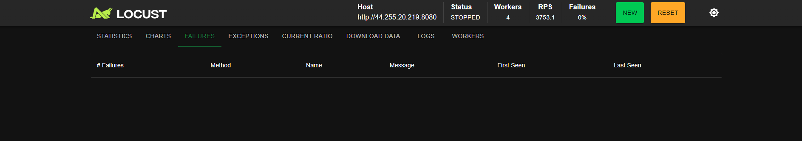

| Users | Throughput | users ÷ 0.09 s | Median latency | What was happening |
|---|---|---|---|---|
| 200 | ~2,200 req/s | 2,222 | ~90 ms | Keeping up. Server CPU already near 100%. |
| 400 | ~3,400 req/s | 4,444 | ~100 ms | Falling short. Requests start waiting. |
| 600 | ~3,700 req/s | 6,666 | ~170 ms | Flat from here on |
| 600 to 2,000 | 3,700 to 4,000 req/s | up to 22,000 | ~170 rising to ~500 ms | More users only add waiting time |

The server's CPU in CloudWatch, at 1-minute resolution (times in UTC, 4 hours ahead of my local time):

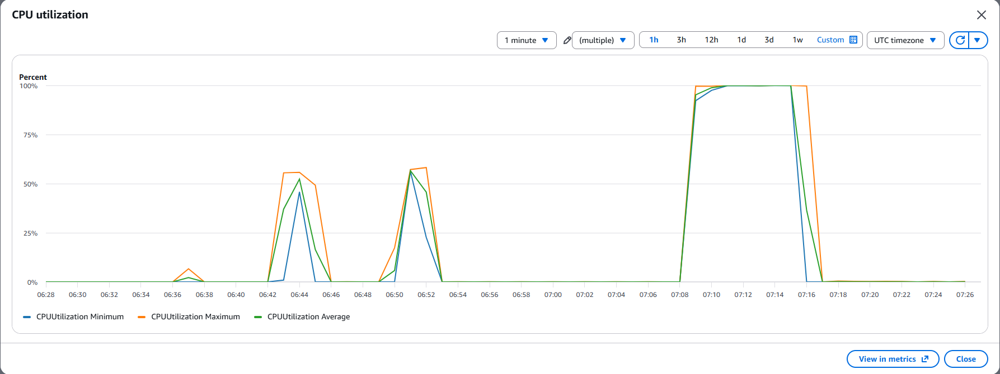

The two bumps at about 55% are the 100-user comparison runs. The flat block at 100% from 07:08 to 07:16 is the stress test.

My laptop stayed well below its limit during the stress test. Each worker used about 40% of a core, and total CPU peaked around 84% without staying at 100%:

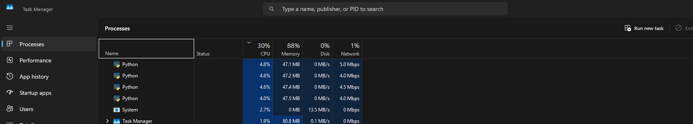
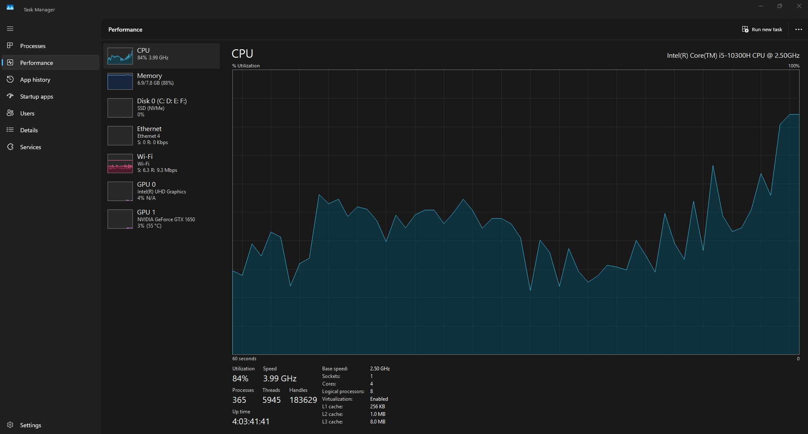

### Where the server started to struggle

The server's CPU was already full at the first step, 200 users and about 2,200 req/s. That fits the comparison runs, where 1,100 req/s used about 55%. Latency still looked normal at that point because requests weren't waiting long yet.

From 400 users it started to show. Throughput fell below what the user count should produce and latency began to climb. From 600 users on, throughput stayed flat at 3,700 to 4,000 req/s whatever the user count, and the median went from about 170 ms to about 500 ms. At 2,000 users and 3,750 req/s each request should take about 2,000 ÷ 3,750 ≈ 0.53 s, which matches the measured latency. The extra time is queueing.

Throughput still rose a bit after the CPU hit 100%. The likely reason is that a busy server does more work per unit of CPU: with requests waiting, Go handles several each time it wakes up, so less time goes into switching between connections. That runs out at around 4,000 req/s on a quarter of a vCPU.

There were no failures because nothing ever refused a request. Go keeps accepting connections and works through the queue, and Locust had no timeout, so slow requests still counted as successes. A client with a 500 ms timeout would have started getting errors at around 1,600 users.

The CPU went to the usual per-request work: parsing HTTP, routing, encoding JSON, and Gin's log line, which ECS ships to CloudWatch for every request. At 3,700 req/s that's 3,700 log lines a second, which isn't free.

### Tradeoffs

**Which operations are most common, and what does that mean for the data structure?** Reads. People look at products much more often than anyone changes them, which is why the test is 80% GET. The map gives a lookup by ID in constant time, and the `sync.RWMutex` lets any number of GETs read at once. Only a POST takes the exclusive lock, and it holds it for microseconds. In the stress test about 560 POSTs a second went through and the lock never showed up as a problem, because the CPU ran out first.

If writes became common, the single lock would turn into the bottleneck, and I'd split the map into shards with a lock each. If the store needed lookups by SKU or category, the map would need a second index, since it only knows IDs. And because everything is in memory, a task restart loses every update, and two ECS tasks would each have their own separate copy. Scaling out would need a shared database or cache.
