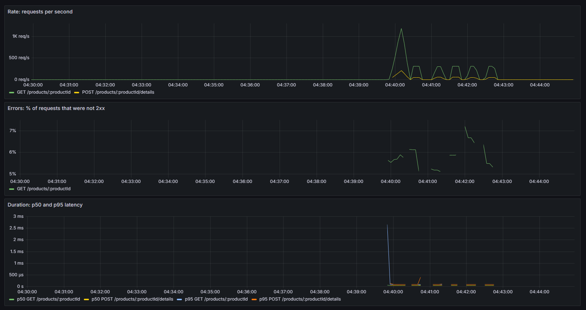

# Product API on ECS

A Go (Gin) implementation of the Product endpoints in `api.yaml`, deployed to AWS ECS (Fargate) with Terraform. This repo is a fork of the starter repo `RuidiH/CS6650_2b_demo`.

## Where things are

```text
.
├── src/                      server code and Dockerfile
│   ├── product-service.go
│   ├── go.mod, go.sum
│   └── Dockerfile
├── terraform/                infrastructure (provider, variables, main, outputs, modules)
├── locust/                   load tests (locustfile.py, stressfile.py)
├── observability/            Prometheus config and Grafana data source and dashboard
├── docker-compose.yml        local stack: API, Prometheus, Grafana
├── requests/                 JSON request bodies used in the curl examples
├── postman/                  Postman collection with one request per response code
└── docs/                     screenshots and the request log excerpt
```

## Deploying to AWS

You need Docker Desktop (running), Terraform, the AWS CLI v2, Git, and an AWS Academy Learner Lab session. Commands are for Windows PowerShell; a bash version of the IP lookup is below.

**1. Clone**

```powershell
git clone https://github.com/ctrlShree/CS6650_HW05.git
cd CS6650_HW05
```

**2. Credentials.** In Learner Lab, click Start Lab, then AWS Details, then AWS CLI: Show. Paste the block into `$HOME\.aws\credentials` (`~/.aws/credentials` on macOS or Linux). Or:

```powershell
aws configure
aws configure set aws_session_token <YOUR-TEMP-SESSION-TOKEN>
```

Check with `aws sts get-caller-identity`. The credentials expire when the lab session ends.

**3. Deploy**

```powershell
cd terraform
terraform init
terraform apply -auto-approve
```

Everything is created in us-west-2 (Oregon).

**4. Find the public IP** (from the `terraform` folder; the task may take a minute to start)

PowerShell:

```powershell
$env:AWS_DEFAULT_REGION = "us-west-2"
$cluster = terraform output -raw ecs_cluster_name
$service = terraform output -raw ecs_service_name
$task = aws ecs list-tasks --cluster $cluster --service-name $service --query "taskArns[0]" --output text
$eni = aws ecs describe-tasks --cluster $cluster --tasks $task --query "tasks[0].attachments[0].details[?name=='networkInterfaceId'].value" --output text
aws ec2 describe-network-interfaces --network-interface-ids $eni --query "NetworkInterfaces[0].Association.PublicIp" --output text
```

bash:

```bash
export AWS_DEFAULT_REGION=us-west-2
CLUSTER=$(terraform output -raw ecs_cluster_name)
SERVICE=$(terraform output -raw ecs_service_name)
TASK=$(aws ecs list-tasks --cluster "$CLUSTER" --service-name "$SERVICE" --query 'taskArns[0]' --output text)
ENI=$(aws ecs describe-tasks --cluster "$CLUSTER" --tasks "$TASK" --query "tasks[0].attachments[0].details[?name=='networkInterfaceId'].value" --output text)
aws ec2 describe-network-interfaces --network-interface-ids "$ENI" --query 'NetworkInterfaces[0].Association.PublicIp' --output text
```

**5. Send requests**

```powershell
curl.exe -i http://<PUBLIC-IP>:8080/products/1
```

Any request in the next section works against AWS by replacing `localhost:8080` with `<PUBLIC-IP>:8080`. The Postman collection in `postman/` can be pointed at AWS by setting its `baseUrl` variable.

## Examples for every response code

The server starts with products 1 to 100. Commands are run from the repo root (on macOS or Linux use `curl` and `@requests/...`).

Run the server locally with:

```powershell
docker build -t product-service ./src
docker run --rm -p 8080:8080 -e ENABLE_FAULT_INJECTION=true product-service
```

`ENABLE_FAULT_INJECTION=true` together with the header `X-Simulate-Error: 500` forces a 500, so that code can be shown. It is off on AWS.

| Endpoint | Request | Code |
|---|---|---|
| GET | `curl.exe -i http://localhost:8080/products/1` | 200 |
| GET | `curl.exe -i http://localhost:8080/products/99999` | 404 |
| GET | `curl.exe -i http://localhost:8080/products/1 -H "X-Simulate-Error: 500"` | 500 |
| POST | `curl.exe -i -X POST http://localhost:8080/products/1/details -H "Content-Type: application/json" --data-binary "@requests\valid.json"` | 204 |
| POST | `curl.exe -i -X POST http://localhost:8080/products/2/details -H "Content-Type: application/json" --data-binary "@requests\valid.json"` | 400 (body ID doesn't match the path) |
| POST | `curl.exe -i -X POST http://localhost:8080/products/1/details -H "Content-Type: application/json" --data-binary "@requests\broken.json"` | 400 (broken JSON) |
| POST | `curl.exe -i -X POST http://localhost:8080/products/99999/details -H "Content-Type: application/json" --data-binary "@requests\missing-product.json"` | 404 |
| POST | `curl.exe -i -X POST http://localhost:8080/products/1/details -H "Content-Type: application/json" -H "X-Simulate-Error: 500" --data-binary "@requests\valid.json"` | 500 |

The Postman collection `postman/product-api.postman_collection.json` contains these requests, each with a status-code test.

**GET 200**


**GET 404**


**GET 500**


**POST 204**


**POST 400, ID mismatch**


**POST 400, broken JSON**


**POST 404**


**POST 500**


## Locust screenshots

Run against the ECS deployment from the `locust` folder.

**HttpUser, 100 users**


**FastHttpUser, 100 users**


**Stress test, 200 to 2,000 users in steps of 200 (`stressfile.py`, 1 master and 4 workers)**


## Grafana dashboard and request logs

The dashboard ran locally with `docker compose up --build` (Grafana at http://localhost:3000, dashboard JSON in `observability/grafana/`). The loaded stretch is the Part IV request mix with 50 users against the local container:

```powershell
locust -f locustfile.py --host http://localhost:8080 --headless -u 50 -r 10 -t 3m ProductFastHttpUser
```

**Idle vs loaded (rate, errors, duration)**


**Log excerpt from the same run** (`docs/request-log-excerpt.jsonl`)

```json
{"time":"2026-10-19T08:39:49.402550734Z","level":"INFO","msg":"request","endpoint":"/products/:productId","method":"GET","path":"/products/50","status":200,"duration_ms":4.107362}
{"time":"2026-10-19T08:39:49.402530732Z","level":"INFO","msg":"request","endpoint":"/products/:productId","method":"GET","path":"/products/21","status":200,"duration_ms":4.31748}
{"time":"2026-10-19T08:39:49.402529132Z","level":"INFO","msg":"request","endpoint":"/products/:productId","method":"GET","path":"/products/50","status":200,"duration_ms":4.343282}
{"time":"2026-10-19T08:39:49.402529132Z","level":"INFO","msg":"request","endpoint":"/products/:productId","method":"GET","path":"/products/83","status":200,"duration_ms":3.925045}
{"time":"2026-10-19T08:39:49.413490597Z","level":"INFO","msg":"request","endpoint":"/products/:productId/details","method":"POST","path":"/products/100/details","status":204,"duration_ms":1.981475}
{"time":"2026-10-19T08:39:49.414820314Z","level":"INFO","msg":"request","endpoint":"/products/:productId/details","method":"POST","path":"/products/34/details","status":204,"duration_ms":2.369209}
{"time":"2026-10-19T08:39:49.423131846Z","level":"INFO","msg":"request","endpoint":"/products/:productId/details","method":"POST","path":"/products/16/details","status":204,"duration_ms":12.207774}
{"time":"2026-10-19T08:39:49.422760613Z","level":"INFO","msg":"request","endpoint":"/products/:productId/details","method":"POST","path":"/products/56/details","status":204,"duration_ms":23.669683}
{"time":"2026-10-19T08:39:49.404792231Z","level":"INFO","msg":"request","endpoint":"/products/:productId","method":"GET","path":"/products/33818","status":404,"duration_ms":8.029206}
{"time":"2026-10-19T08:39:49.414878419Z","level":"INFO","msg":"request","endpoint":"/products/:productId","method":"GET","path":"/products/24779","status":404,"duration_ms":0.333129}
{"time":"2026-10-19T08:39:49.427416223Z","level":"INFO","msg":"request","endpoint":"/products/:productId","method":"GET","path":"/products/40493","status":404,"duration_ms":0.023902}
```

**Dashboard or logs?** I'd look at the dashboard while something is happening, to see whether the error rate or latency is moving and when it started. I'd go to the logs afterwards, when I need the individual requests behind a problem, such as which path returned the errors or how long each request took.
